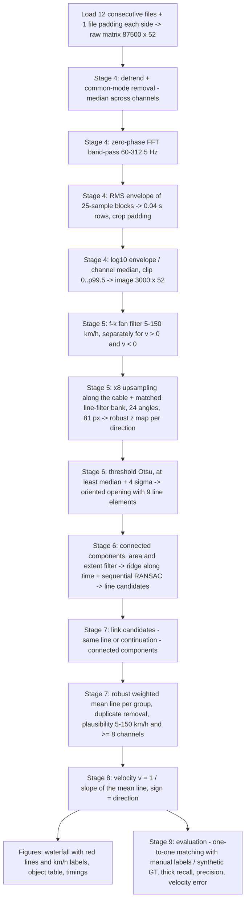

# Algorithm flowchart

Mermaid source of the block diagram. The report figure `report/figures/flowchart.png` is drawn
with matplotlib by `scripts/make_report_figures.py` (same blocks, plus what each block removes),
so no external tool is needed.

